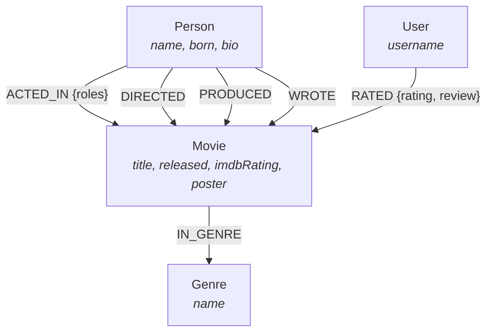

# OmniFlix — Graph-Powered Movie & Talent Intelligence

A full-stack web application backed by **CognoDB** (an openCypher/Bolt graph database) and the official `neo4j-driver`. Built for exploring movie catalogs, actor-director networks, multi-hop recommendation paths, and "Degrees of Separation" traversals.

---

## Why a Graph Database?

Relational databases (SQL) work well for tabular records, but they struggle when the primary questions are about **connections, paths, and arbitrary-depth relationships**.

### 1. Multi-Hop Shortest Path (Degrees of Separation)
- **The SQL Problem**: To find how Actor A is connected to Actor B through shared movies and co-stars, a relational database requires recursive Common Table Expressions (CTEs) or multiple self-joins across junction tables (`movie_cast`, `movie_crew`). With each added hop, query complexity and execution time explode exponentially ($O(d^k)$ join operations).
- **The Graph Solution**: Graph databases use *index-free adjacency* — each node directly stores pointers to its connected edges. Traversing 4 or 6 degrees of separation is a single readable Cypher query:
  ```cypher
  MATCH (p1:Person {name: $actor1}), (p2:Person {name: $actor2})
  MATCH path = shortestPath((p1)-[:ACTED_IN|DIRECTED*..12]-(p2))
  RETURN path, length(path) AS degree;
  ```

### 2. Multi-Dimensional Recommendation Scoring
- In SQL, recommending a movie based on shared cast, directors, and genres simultaneously requires multi-table outer joins, subqueries, and heavy grouping.
- In openCypher, we can traverse 2-hop neighborhood subgraphs in a single query and calculate weighted relevance scores (e.g., shared directors = 4 pts, shared actors = 3 pts, shared genres = 2 pts) in real time.

### 3. Schema Flexibility
- Adding new relationships (like `PRODUCED`, `WROTE`, or `RATED`) doesn't require complex table migrations or `ALTER TABLE` locks.

---

## Graph Data Model



### Nodes & Relationships
- **`Movie`**: Core titles (`title`, `released`, `tagline`, `overview`, `imdbRating`, `duration`, `poster`).
- **`Person`**: Cast and crew members (`name`, `born`, `bio`).
- **`Genre`**: Movie categories (`name`).
- **`User`**: Reviewers and user accounts (`username`).
- **Relationships**: `(:Person)-[:ACTED_IN {roles}]->(:Movie)`, `(:Person)-[:DIRECTED]->(:Movie)`, `(:Movie)-[:IN_GENRE]->(:Genre)`, and `(:User)-[:RATED {rating, review}]->(:Movie)`.

---

## Key Cypher Queries

All queries are executed with parameterized inputs through the official `neo4j-driver`.

### 1. Degrees of Separation (Shortest Path)
Finds the shortest link between any two people in the industry (co-stars or director relationships):
```cypher
MATCH (p1:Person {name: $person1}), (p2:Person {name: $person2})
MATCH path = shortestPath((p1)-[:ACTED_IN|DIRECTED*..12]-(p2))
RETURN path, length(path) AS degree, [n in nodes(path) | { labels: labels(n), name: coalesce(n.name, n.title) }] AS pathNodes;
```

### 2. Multi-Hop Graph Recommendations
Finds candidate movies connected through 2-hop graph paths and ranks them by affinity score:
```cypher
MATCH (m:Movie {title: $title})
OPTIONAL MATCH (m)<-[:ACTED_IN]-(a:Person)-[:ACTED_IN]->(recA:Movie) WHERE recA <> m
OPTIONAL MATCH (m)<-[:DIRECTED]-(d:Person)-[:DIRECTED]->(recD:Movie) WHERE recD <> m
OPTIONAL MATCH (m)-[:IN_GENRE]->(g:Genre)<-[:IN_GENRE]-(recG:Movie) WHERE recG <> m
WITH coalesce(recA, recD, recG) AS rec,
     count(DISTINCT a) AS sharedActorCount,
     collect(DISTINCT a.name) AS sharedActors,
     count(DISTINCT d) AS sharedDirectorCount,
     collect(DISTINCT d.name) AS sharedDirectors,
     count(DISTINCT g) AS sharedGenreCount,
     collect(DISTINCT g.name) AS sharedGenres
WHERE rec IS NOT NULL
WITH rec, (sharedActorCount * 3 + sharedDirectorCount * 4 + sharedGenreCount * 2) AS relevanceScore,
     sharedActors, sharedDirectors, sharedGenres
RETURN {
  title: rec.title,
  released: rec.released,
  poster: rec.poster,
  imdbRating: rec.imdbRating,
  relevanceScore: relevanceScore,
  reasons: { sharedActors: sharedActors, sharedDirectors: sharedDirectors, sharedGenres: sharedGenres }
} AS recommendation
ORDER BY recommendation.relevanceScore DESC, recommendation.imdbRating DESC
LIMIT $limit;
```

### 3. Frequent Co-Star Collaborations
Finds actor pairs who frequently co-star across distinct films:
```cypher
MATCH (p1:Person)-[:ACTED_IN]->(m:Movie)<-[:ACTED_IN]-(p2:Person)
WHERE id(p1) < id(p2)
WITH p1, p2, count(m) AS sharedMoviesCount, collect(m.title) AS movieTitles
WHERE sharedMoviesCount >= 2
RETURN p1.name AS actor1, p2.name AS actor2, sharedMoviesCount, movieTitles
ORDER BY sharedMoviesCount DESC;
```

---

## Features

- **Movie Catalog & CRUD**: Add new movies (with automatic relationship generation to cast/directors/genres), search by title/actor/director, filter by genre/year, edit metadata, and delete nodes.
- **Interactive 2D Graph Visualizer**: Built on HTML5 Canvas with force-directed physics, alpha cooling (no jitter), node dragging, zoom/pan, and click-to-expand.
- **Degrees of Separation**: Visual breadcrumb trail showing the exact connection hops between any two actors.
- **openCypher Console**: Live interactive query playground to run read queries directly against CognoDB with instant JSON output and execution time metrics.
- **Resilient Connection Handling**: Connection pooling with auto-reconnect logic if cloud sockets idle out.

---

## Tech Stack

- **Backend**: Node.js (ES Modules), Express.js
- **Database**: CognoDB (managed openCypher graph database over Bolt 5.x protocol)
- **Database Driver**: `neo4j-driver` (v5.x)
- **Frontend**: Vanilla JavaScript (ES Modules), HTML5 Canvas, modern CSS (Apple-inspired dark UI with SF Pro typography and glassmorphism)

---

## Project Structure

```
cognodb-test-app/
├── server.js                 # Express server & API routes mount
├── package.json              # Project dependencies and scripts
├── .env.example              # Environment variables template
├── .gitignore                # Git exclusions (protects .env)
├── README.md                 # Project documentation & queries
├── src/
│   ├── config/
│   │   └── database.js       # Neo4j driver connection pool & health checks
│   ├── routes/
│   │   └── api.js            # REST API endpoints
│   ├── services/
│   │   └── movieService.js   # Parameterized openCypher queries
│   └── scripts/
│       ├── seed.js           # Database seeder (loads 17+ movies & relationships)
│       └── queries.cypher    # Catalog of all Cypher queries
└── public/
    ├── index.html            # Main web UI
    ├── css/
    │   └── styles.css        # Clean dark-mode stylesheet
    └── js/
        ├── app.js            # UI controller & event listeners
        ├── api.js            # Fetch API wrapper
        └── graphVisualizer.js# Force-directed Canvas physics visualizer
```

---

## Getting Started

### 1. Prerequisites
- Node.js (v18 or higher)
- A free CognoDB Cloud account: [https://console.cognodb.com/signup](https://console.cognodb.com/signup)

### 2. Clone & Install
```bash
git clone https://github.com/Saurabh-Duryodhan/cognodb-test-app.git
cd cognodb-test-app
npm install
```

### 3. Configure Environment Variables
Create a `.env` file from `.env.example`:
```bash
cp .env.example .env
```
Fill in your CognoDB instance details:
```env
COGNO_URI=bolt+s://<instance-id>.databases.cognodb.com
COGNO_USER=cognodb
COGNO_PASSWORD=your_password
PORT=3000
```

### 4. Seed the Database
Populate your CognoDB instance with realistic movie data:
```bash
npm run seed
```

### 5. Run the Server
```bash
npm start
```
Open [http://localhost:3000](http://localhost:3000) in your browser.

---

## Deployment (Render / Railway)

This app is ready to deploy on any Node.js hosting platform:

1. Push your repository to GitHub.
2. Create a new **Web Service** on [Render](https://render.com) or [Railway](https://railway.app).
3. Set:
   - **Build Command**: `npm install`
   - **Start Command**: `npm start`
4. Add your `COGNO_URI`, `COGNO_USER`, and `COGNO_PASSWORD` in the platform's Environment Variables settings.

---

## Submission Details

- **Author**: Saurabh R. Duryodhan
- **Assignment**: Wexa AI Take-Home Assignment — Build a Graph Database Application
- **Database**: CognoDB Cloud (Bolt 5.x / openCypher)
