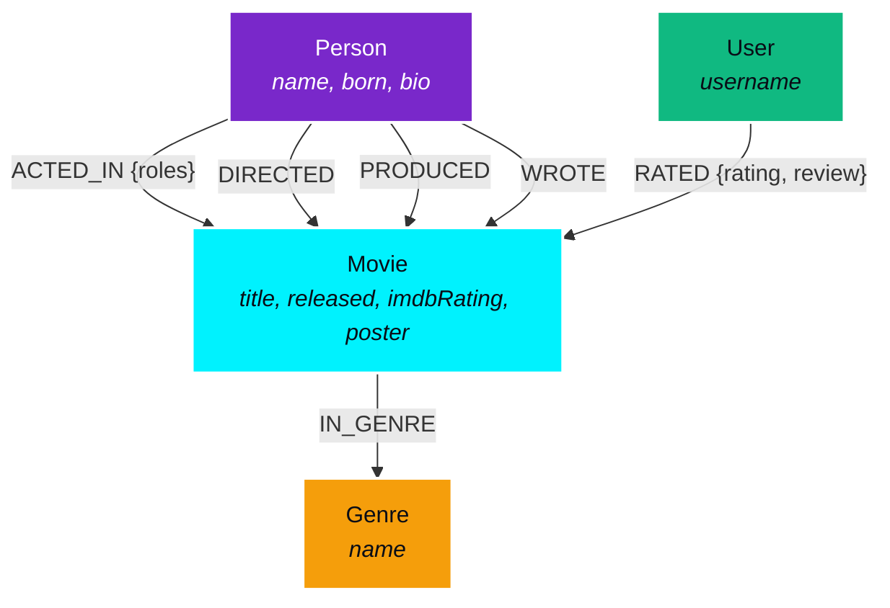

#  OmniFlix Enterprise — Studio Knowledge & Graph Intelligence Platform

> An enterprise graph database web application backed by **CognoDB Cloud** (openCypher over Bolt 5.x) with full studio catalog management, multi-hop talent network analysis, interactive force-directed graph visualizer, and AI-assisted collaborative recommendation discovery.

[](https://console.cognodb.com)
[](https://neo4j.com/docs/bolt/current/)
[](https://www.npmjs.com/package/neo4j-driver)
[](https://nodejs.org)

---

## 📖 Table of Contents
1. [Why a Graph Database?](#-why-a-graph-database)
2. [Graph Data Model & Architecture](#-graph-data-model--architecture)
3. [Core Cypher Queries Explained](#-core-cypher-queries-explained)
4. [Application Features & UI/UX](#-application-features--uiux)
5. [Prerequisites & CognoDB Setup](#-prerequisites--cognodb-setup)
6. [Local Installation & Run Guide](#-local-installation--run-guide)
7. [Environment Variables](#-environment-variables)
8. [Free Cloud Deployment Guide](#-free-cloud-deployment-guide)

---

## 💡 Why a Graph Database?

Relational databases (RDBMS/SQL) excel at storing tabular records in structured rows and columns. However, in modern media catalogs, recommendation engines, and social graphs, **the most valuable insights live in the relationships between entities** rather than the rows themselves.

### 1. Arbitrary-Depth & Shortest-Path Traversal (Degrees of Separation)
- **In SQL (Relational)**: Finding the shortest connection path between two actors across co-starred films requires complex recursive Common Table Expressions (CTEs), multiple self-joins against join tables (`movie_cast`, `movie_directors`), and suffers from exponential execution time degradation ($O(d^k)$ join Cartesian products).
- **In CognoDB (openCypher)**: Index-free adjacency allows the database to traverse relationships in $O(k)$ pointer-chasing time:
  ```cypher
  MATCH (p1:Person {name: $actor1}), (p2:Person {name: $actor2})
  MATCH path = shortestPath((p1)-[:ACTED_IN|DIRECTED*..12]-(p2))
  RETURN path, length(path) AS degree;
  ```

### 2. Multi-Dimensional Collaborative Recommendation Scoring
- **In SQL**: Recommending movies based on shared actors, directors, and genres simultaneously requires multi-table `OUTER JOIN` queries with sub-select group counts that are error-prone and hard to maintain.
- **In openCypher**: Graph pattern matching allows traversing $2$-hop neighbor subgraphs effortlessly and calculating affinity scores in real-time.

### 3. Flexible Schema Evolution Without Migrations
- Graph models naturally evolve without destructive `ALTER TABLE` schema locks. Adding new relationships (e.g., `WROTE`, `PRODUCED`, `STUDIED_WITH`, `FOLLOWS`, or `USER_RATED`) requires zero downtime or table rewrites.

---

## 📐 Graph Data Model & Architecture

### Entity-Relationship Diagram (ERD / Graph Topology)



### Labeled Nodes
- **`Movie`**: Represents films (`title`, `released`, `tagline`, `overview`, `imdbRating`, `duration`, `poster`).
- **`Person`**: Represents actors, directors, writers, and producers (`name`, `born`, `bio`, `image`).
- **`Genre`**: Represents movie categories (`name`).
- **`User`**: Represents community reviewers (`username`).

### Typed Relationships
- `(Person)-[:ACTED_IN {roles: [...]}]->(Movie)`
- `(Person)-[:DIRECTED]->(Movie)`
- `(Person)-[:PRODUCED]->(Movie)`
- `(Person)-[:WROTE]->(Movie)`
- `(Movie)-[:IN_GENRE]->(Genre)`
- `(User)-[:RATED {rating: Float, review: String, timestamp: Int}]->(Movie)`

---

## ⚡ Core Cypher Queries Explained

All queries use strict parameterization with the official `neo4j-driver` (no unsafe string concatenation).

### 1. Multi-Hop Shortest Path ("Degrees of Separation")
Traverses the cast/crew graph up to 12 hops to find the closest professional link between any two figures:
```cypher
MATCH (p1:Person {name: $person1}), (p2:Person {name: $person2})
MATCH path = shortestPath((p1)-[:ACTED_IN|DIRECTED*..12]-(p2))
RETURN path, length(path) AS degree, [n in nodes(path) | { labels: labels(n), name: coalesce(n.name, n.title) }] AS pathNodes;
```

### 2. Multi-Hop Graph Recommendation Algorithm
Computes relevance score using weighted affinities (Shared Director: 4 pts, Shared Actor: 3 pts, Shared Genre: 2 pts):
```cypher
MATCH (m:Movie {title: $title})
OPTIONAL MATCH (m)<-[:ACTED_IN]-(a:Person)-[:ACTED_IN]->(recA:Movie) WHERE recA <> m
OPTIONAL MATCH (m)<-[:DIRECTED]-(d:Person)-[:DIRECTED]->(recD:Movie) WHERE recD <> m
OPTIONAL MATCH (m)-[:IN_GENRE]->(g:Genre)<-[:IN_GENRE]-(recG:Movie) WHERE recG <> m
WITH coalesce(recA, recD, recG) AS rec,
     count(DISTINCT a) AS sharedActorCount,
     collect(DISTINCT a.name) AS sharedActors,
     count(DISTINCT d) AS sharedDirectorCount,
     collect(DISTINCT d.name) AS sharedDirectors,
     count(DISTINCT g) AS sharedGenreCount,
     collect(DISTINCT g.name) AS sharedGenres
WHERE rec IS NOT NULL
WITH rec, (sharedActorCount * 3 + sharedDirectorCount * 4 + sharedGenreCount * 2) AS relevanceScore,
     sharedActors, sharedDirectors, sharedGenres
RETURN {
  title: rec.title,
  released: rec.released,
  poster: rec.poster,
  imdbRating: rec.imdbRating,
  relevanceScore: relevanceScore,
  reasons: { sharedActors: sharedActors, sharedDirectors: sharedDirectors, sharedGenres: sharedGenres }
} AS recommendation
ORDER BY recommendation.relevanceScore DESC, recommendation.imdbRating DESC
LIMIT $limit;
```

### 3. Frequent Co-Star Collaborations
Discovers actor pairs who frequently co-star across distinct films:
```cypher
MATCH (p1:Person)-[:ACTED_IN]->(m:Movie)<-[:ACTED_IN]-(p2:Person)
WHERE id(p1) < id(p2)
WITH p1, p2, count(m) AS sharedMoviesCount, collect(m.title) AS movieTitles
WHERE sharedMoviesCount >= 2
RETURN p1.name AS actor1, p2.name AS actor2, sharedMoviesCount, movieTitles
ORDER BY sharedMoviesCount DESC;
```

### 4. Parameterized CRUD (Create / Update Movie)
Creates movie nodes and links relationships in a single transactional unit:
```cypher
MERGE (m:Movie {title: $title})
SET m.released = $released, m.tagline = $tagline, m.poster = $poster,
    m.imdbRating = $imdbRating, m.overview = $overview, m.duration = $duration,
    m.updatedAt = timestamp()
WITH m
UNWIND $directors AS directorName
MERGE (d:Person {name: directorName})
MERGE (d)-[:DIRECTED]->(m)
WITH m
UNWIND $cast AS actorItem
MERGE (a:Person {name: actorItem.name})
MERGE (a)-[r:ACTED_IN]->(m)
SET r.roles = coalesce(actorItem.roles, ['Cast'])
WITH m
UNWIND $genres AS genreName
MERGE (g:Genre {name: genreName})
MERGE (m)-[:IN_GENRE]->(g)
RETURN m.title AS title;
```

---

## 🎨 Application Features & UI/UX

1. **Full CRUD Operations**:
   - **Create**: Add new movies with auto-relationship generation to Directors, Cast members, and Genres.
   - **Read**: Live search by title/tagline, genre filter chips, and minimum release year slider.
   - **Update**: Edit movie metadata, update cast members and character roles.
   - **Delete**: Safe detach deletion removing the movie and associated relations from the graph.
2. **Interactive 2D Force-Directed Graph Visualizer**:
   - Pure HTML5 Canvas physics engine with spring forces and repulsion.
   - Color-coded node halos by label (`Movie`: Cyan, `Person`: Purple, `Genre`: Amber, `User`: Emerald).
   - Pan, zoom, node drag-and-drop, and click-to-expand localized subgraphs.
3. **Degrees of Separation Explorer**:
   - Step-by-step breadcrumb trail showing the shortest path between any two figures (e.g. *Leonardo DiCaprio* $\to$ *Inception* $\to$ *Christopher Nolan* $\to$ *The Dark Knight* $\to$ *Morgan Freeman*).
4. **openCypher Console**:
   - Pre-loaded query templates and interactive query editor with live JSON output and latency counters.
5. **Real-Time CognoDB Status Pill**:
   - Heartbeat latency monitor and graceful offline/reconnect handling.

---

## 🛠️ Prerequisites & CognoDB Setup

1. **Sign up for CognoDB Cloud**:
   - Go to [https://console.cognodb.com/signup](https://console.cognodb.com/signup) (Free tier, no credit card required).
2. **Create a Free Instance**:
   - In the console, create a free (`c0`) instance and choose your region.
3. **Save Connection Credentials**:
   - Note the `bolt+s://<instance-id>.databases.cognodb.cloud` URI.
   - Note the generated password for user `cognodb`.

---

## 🚀 Local Installation & Run Guide

### 1. Clone the repository
```bash
git clone https://github.com/<your-username>/cognodb-movie-graph-app.git
cd cognodb-movie-graph-app
```

### 2. Install dependencies
```bash
npm install
```

### 3. Configure environment variables
Create a `.env` file from `.env.example`:
```bash
cp .env.example .env
```
Fill in your CognoDB credentials:
```env
COGNO_URI=bolt+s://<instance-id>.databases.cognodb.cloud
COGNO_USER=cognodb
COGNO_PASSWORD=your_password_here
PORT=3000
```

### 4. Seed the Graph Database
Run the idempotent seed script to load sample movies, cast networks, genres, and community reviews:
```bash
npm run seed
```

### 5. Start the Application
```bash
npm start
```
Open your browser at `http://localhost:3000`.

---

## ☁️ Free Cloud Deployment Guide

You can deploy this application for free on **Render**, **Railway**, or **Vercel**:

### Option A: Render (Web Service)
1. Push your repository to GitHub.
2. Go to [Render Dashboard](https://dashboard.render.com) $\to$ **New Web Service** $\to$ Connect your GitHub repo.
3. Set **Build Command**: `npm install`
4. Set **Start Command**: `npm start`
5. Add Environment Variables:
   - `COGNO_URI`: `bolt+s://<instance-id>.databases.cognodb.cloud`
   - `COGNO_USER`: `cognodb`
   - `COGNO_PASSWORD`: `<your-password>`
6. Click **Deploy**. Render will provide a free live URL (e.g. `https://cinegraph-app.onrender.com`).

---

## 📂 Project Structure

```
cognodb-test-app/
├── package.json              # Project manifest and scripts
├── .env                      # Local secret variables (git-ignored)
├── .env.example              # Template environment configuration
├── .gitignore                # Protected file exclusions
├── README.md                 # Complete documentation & architecture
├── server.js                 # Express server & static asset host
├── src/
│   ├── config/
│   │   └── database.js       # CognoDB driver pool & connection manager
│   ├── routes/
│   │   └── api.js            # REST API endpoints & route handlers
│   ├── services/
│   │   └── movieService.js   # Parameterized openCypher queries & business logic
│   └── scripts/
│       ├── seed.js           # Database seed ingestion script
│       └── queries.cypher    # Raw openCypher query catalog
└── public/
    ├── index.html            # Single page dashboard application
    ├── css/
    │   └── styles.css        # Modern glassmorphism & dark-mode design system
    └── js/
        ├── api.js            # Client HTTP API connector
        ├── app.js            # UI state, modals, filters & query inspector
        └── graphVisualizer.js# Interactive Canvas force-directed graph visualizer
```

---

## 👥 Author & Submission Details
- **Candidate**: Saurabh R. Duryodhan
- **Assignment**: Wexa AI Take-Home Assignment — Build a Graph Database Application
- **Database**: CognoDB (Bolt 5.x / openCypher)
